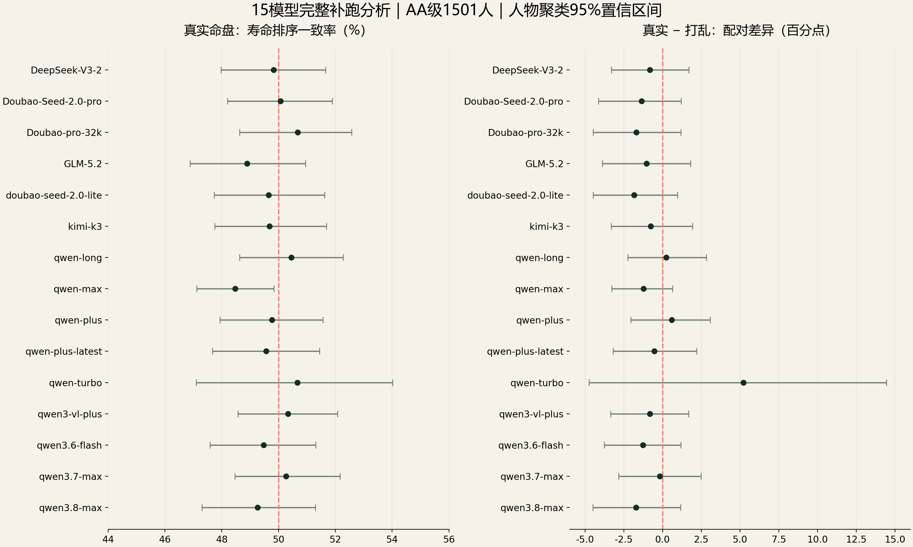

# AI算命到底准不准？我们拿1712人的真实寿命做了盲测

AI++ · 实验 01 · 2026-10-11

**结果：本次实验未发现真实命盘具有稳定的寿命排序优势。**

在补充分析的 AA 级 1501 人中，15 个可用模型的真实命盘寿命排序一致率为 **48.5%–50.7%**，随机或恒定预测基准为 **50%**。15 个模型“真实命盘 − 打乱命盘”的人物聚类 95% 置信区间全部跨过 0。结果方向与保留的原始 18 模型首试主分析一致。

## 我们怎么做

1. 从 Astrodatabank 的 C 首字母导出样本筛选已故公众人物，纳入 2173 人；461 人用于校准，1712 人留作评价（AA 1501，A 211）。
2. 冻结《子平真诠》《滴天髓辑要》《穷通宝鉴》的 45 条/段规则。根据日干和季节，每份提示选用 5 条通则与 1 段季节规则。
3. 模型只收到匿名命盘、选定规则和结构化输出要求。姓名、生平、公历生日、出生地、来源链接与真实寿命不进入模型提示。
4. 要求“事实 → 规则 ID 与适用条件 → 推导 → 定性寿夭倾向”。没有依据时允许弃权，不编造古籍到具体死亡年龄或概率的映射。
5. 真实命盘与固定打乱命盘分别测试，每种条件重复 3 次。打乱主要在同性别和 50 年出生队列内完成；**4 条映射因队列单例回退到同性别其他队列**，是实际实现相对严格同队列描述的例外。
6. 用真实寿命排序检验预测，另用两位自动评委按 F1–F6 量表审查理论推导。规则存在、来源、遵循程度和预测能力分别解释。

## 两套结果，请分开看

| 分析 | 模型 | 取答案的方式 | 用途 |
|---|---:|---|---|
| 原始主分析 | 18 | 每格仅第 1 次尝试，且原文完整、格式有效 | 保留冻结主结果 |
| 完整补跑的补充分析 | 15 | 历次批次每格首个有效回答；已完成格不重发 | 检查补齐缺失后的结论 |

15 模型共收齐 **1712 × 15 × 2 × 3 = 154080** 份结构有效回答。模型按运行可用性选择，未按成绩挑选；型号名称是实验平台的路由标识，不能保证与厂商同名产品的底层版本逐一相同，也不等于 15 个独立模型家族。

“结构有效”不等于做出了预测。insufficient 与识别出身份的回答记缺失。不同模型覆盖率差别很大，AA 真实命盘条件约为 14.9%–100%；配对分析只使用两种条件均有预测的人物。详见数据中的 coverage、n_people、paired_people，不能只比较点估计。

## 怎么评分与画误差棒

- long = 1，balanced = 0，short = -1；insufficient/识别身份为缺失，不是 0 分。
- 同一人物的有效重复先取均值，再在同一性别、50 年出生队列内比较人物对的真实寿命排序；预测平局记 0.5，真实寿命相等的人物对不进入该指标。
- 误差棒采用 2000 次分层人物聚类影响函数自助法，是线性化近似。154080 次回答不视作 154080 个独立人物。
- 报告人物覆盖率、可配对人物数、人物内重复 SD 与 95% CI。主图是 AA 群体，另外保留全样本、剔除时间边界、剔除已编码外因死亡的敏感性分析。
- 正向残差关联的置换检验按原 18 模型家族做 Holm 校正。这个 p 值不直接检验配对一致率差值。
- 所有 AA 主群体配对区间跨 0，不等于已证明完全相等。部分敏感性分析出现负向差异，也没有支持正向预测优势。

## 公开了什么

- [统计数据表](data/model_results.csv)：15 模型 AA 图表所用数值。
- [补充分析完整汇总](data/supplemental.aggregate.json)：4 个群体、2 个条件、置信区间、覆盖率、重复 SD、配对结果与置换检验。
- [原始主分析汇总](data/primary.aggregate.json)：18 模型原始首试结果与推导审查汇总。
- [数据清单](data/inventory.json)、[冻结协议](config/v3/protocol.json)、[量表](config/v3/rubric.json)、[理论规则与来源](theory/v3/rules.json)。
- src/：数据构建、提示词、任务构建、断点队列、原主分析、补充分析和统计实现。
- [数据可用性说明](docs/DATA_AVAILABILITY.md)、[执行与方法说明](docs/METHOD_NOTES.md)。

## 快速复现公开结果

Python 3.10+。以下命令在本实验目录运行，不调用模型、不需要账号：

~~~bash
python -m pip install -r requirements.txt
python tests/v3/statistics_test.py
python src/reproduce_public.py
~~~

最后一条会核对样本量、覆盖率、15 模型结果、CSV 与 JSON 一致性，重新生成 figures/reproduced_results.png 和 data/reproduced_model_results.csv。它复现的是**已公开汇总数据的图表与结论检查**，并不能从汇总表独立重算人物聚类置信区间。

如需从逐人输入重算，须先向数据来源获取允许研究使用的同版 XML，再按 [数据可用性说明](docs/DATA_AVAILABILITY.md) 在本地重建。原始模型原文与逐人寿命数据没有在本仓库再分发；因此本公开包**不提供一键完整复现原始 154080 份回答**。新调用也会受随机性及上游版本变化影响。

## 结论边界

本研究检验的是本次固定理论、指定模型路由和资料样本的定性寿夭预测。样本是 C 首字母、已故公众人物的便利样本；AA/A 是发布方评级，未逐份独立核验出生证。匿名输入不能完全排除模型对命盘的记忆。自动评委尚未独立校准为人工金标准。本实验不能推广成对所有命理流派或一般人口的最终判决，更不应用于个人死亡年龄预测。

**你还想看 AI + 什么？把想验证的问题留给 AI++。**
